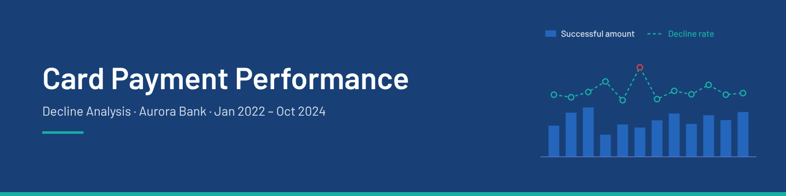

# Card Payment Performance: Aurora Bank (Jan 2022 – Oct 2024)


A Power BI report that answers two questions for the Card Division: how reliable card payments are today, and which group of declined transactions should be addressed first.

## Table of Contents

1. [Background & Overview](#1-background--overview)
2. [Dataset Description & Data Structure](#2-dataset-description--data-structure)
3. [Design Thinking Process](#3-design-thinking-process)
4. [Main Process](#4-main-process)
5. [Key Insights & Visualizations](#5-key-insights--visualizations)
6. [Final Conclusion & Recommendations](#6-final-conclusion--recommendations)

---

## 1. Background & Overview

Between January 2022 and October 2024, Aurora Bank recorded 157,224 card transactions, of which 1.74% (2,738 transactions) were declined. Each team tracks errors in its own report with its own definitions, so the Card Division has no shared view to answer the following:

- Is the decline rate currently rising?
- Are declines caused by customers, by the bank's systems, or by security checks?
- Which group of transactions should be addressed first, and which team owns it?
- Which transactions look unusual and need to be reviewed right away?

The report is built for the Head of Card Division, who assigns follow-up actions after each monthly meeting, and for the team leads involved:

| User | Main need |
| --- | --- |
| Head of Card Division | Understand the overall picture and assign work to the right team |
| Card Product | Know where insufficient-balance declines happen and which customers they affect |
| Digital Payments | Understand why the online channel has more declines than the other channels |
| Risk Operations | Have a list of unusual transactions, ranked by review priority |

---

## 2. Dataset Description & Data Structure

### Table Schema

The data covers Aurora Bank card transactions from January 2022 to October 2024. Four tables come from the bank's source files (transactions, customers, cards and merchant category codes), and two supporting tables were created in Power BI with DAX.

| Table | Content | Grain | Rows |
| --- | --- | --- | --- |
| fact_transactions_data | Every card transaction: date, amount, payment channel, merchant category, and decline reason | One transaction | 157,224 |
| dim_users_data | List of customer IDs | One customer | 2,000 |
| dim_cards_data | List of card IDs and their card type | One card | 6,146 |
| dim_mcc_codes | Merchant category codes, their names, and the category group each code belongs to | One MCC code | 109 |
| dim_date | Calendar covering every day from the first to the last transaction (created with DAX) | One day | 1,035 |
| dim_error | List of decline reasons and the reason group each one is shown under in the charts (created with DAX) | One decline reason | 10 |

Of the 2,000 customers and 6,146 cards, only 303 customers and 896 cards have transactions. The findings in the report therefore apply to active card users.

<details>
<summary><b>fact_transactions_data</b></summary>

| Column | Description |
| --- | --- |
| id | Transaction ID (primary key) |
| date | Date and time of the transaction |
| client_id | Customer ID (key to the customer table) |
| card_id | Card ID (key to the card table) |
| amount | Transaction amount in USD; negative values are refunds |
| use_chip | Payment channel: Chip Transaction, Swipe Transaction, Online Transaction |
| mcc_id | Merchant category code (key to the MCC table), renamed from `mcc` |
| errors | Decline reason; blank if the transaction succeeded, several reasons are separated by commas |
| Transaction Date | Added column: date without the time (key to the date table) |
| Channel | Added column: short channel name (Chip, Swipe, Online) |
| Error Type | Added column: cleaned decline reason, *No Error* if successful, *Multiple Errors* if there are two or more reasons (key to the error table) |
| Error Attempt Flag | Added column: 1 if the transaction was declined, 0 if it succeeded |
| Peer Amount Percentile | Added column: rank of the amount (0–100) among transactions with the same MCC and channel |
| T1–T4 Flags | Added columns: 1 if the transaction meets rule T1 High Value, T2 Peer Outlier, T3 Authentication Error or T4 Multiple Errors |
| Triggered Rules | Added column: names of the rules the transaction meets |
| Rule Combination | Added column: the rules met, joined with "+", for transactions that meet two or more rules |
| Review Priority | Added column: Urgent, High, Monitor or No Flag |

</details>

<details>
<summary><b>dim_users_data</b></summary>

| Column | Description |
| --- | --- |
| id | Customer ID (primary key) |

</details>

<details>
<summary><b>dim_cards_data</b></summary>

| Column | Description |
| --- | --- |
| id | Card ID (primary key) |
| card_type | Card type: Credit, Debit, or Debit (Prepaid), used for the Card Type slicer |

</details>

<details>
<summary><b>dim_mcc_codes</b></summary>

| Column | Description |
| --- | --- |
| mcc_id | Merchant category code (primary key) |
| Description | Name of the merchant category, for example Grocery Stores, Supermarkets |
| MCC Group | Added column: the category group the code belongs to, one of 14 groups such as Food, Retail, Financial Services |
| MCC Label | Added column: code and name shown together, for example *5411 - Grocery Stores, Supermarkets* |

</details>

<details>
<summary><b>dim_date</b></summary>

| Column | Description |
| --- | --- |
| Date | Calendar date (primary key) |
| Year | Year of the date, used for the Year slicer |
| Month Start | First day of the month, used to group the monthly charts |

</details>

<details>
<summary><b>dim_error</b></summary>

| Column | Description |
| --- | --- |
| Error Type | Decline reason (primary key): Insufficient Balance, Bad PIN, Technical Glitch, Bad Card Number, Bad Expiration, Bad CVV, Bad Zipcode, Multiple Errors, Unclassified Error, and No Error |
| Decline Reason Group | Group shown in the charts: Insufficient Balance, Bad PIN, Technical Glitch, Card Details (wrong card number, expiration date, or CVV), and Other |
| Reason Group Sort, Error Sort | Hidden columns that set the display order of the groups and reasons |

</details>

### Data Relationships


<details>
<summary><b>Relationships</b></summary>

The model follows a star schema, with the fact table `fact_transactions_data`, three dimension tables taken from the source data, and two helper tables built in the model:

- `dim_users_data[id]` relates to `client_id` in the transactions table.
- `dim_cards_data[id]` relates to `card_id`.
- `dim_mcc_codes[mcc_id]` relates to `mcc_id`.
- `dim_date` is a date table (`Date`, `Month Start`, `Year`) linked to the transaction date, used for the Year slicer and the monthly charts.
- `dim_error` lists each `Error Type` with its `Decline Reason Group` and sort order, linked on `Error Type`, used for the Decline Reason slicer and the reason charts.
- All relationships are one-to-many, filtering in a single direction from dimension to fact.

</details>

---

## 3. Design Thinking Process

Before building the report, I used Design Thinking to clarify who the audience is, what decisions they need to make, and which metrics should measure success.

> [!TIP]
> **Step 1: Empathize.** The primary audience is the Head of Card Division. The need is framed as a single verb: *prioritize* which errors to fix first and assign them to the right team. From there, I defined seven key questions for the report, moving from the success rate, to where errors are concentrated, to the list of transactions that need review.

<details>
<summary><b><i>5W1H</i></b></summary>


</details>

<details>
<summary><b><i>Empathy Map</i></b></summary>


</details>

<details>
<summary><b><i>Explore Dataset</i></b></summary>


</details>

> [!TIP]
> **Step 2: Define Point of View.** Two North Star metrics were selected: *Success Rate* (the share of successful transactions, used as the primary metric) and *Successful Amount* (the value of successful transactions net of refunds, used for context). Four points of view were then chosen: decline reason, payment channel, merchant category group, and transaction risk level.

<details>
<summary><b><i>North Star Metric</i></b></summary>


</details>

<details>
<summary><b><i>Define Point of View</i></b></summary>


</details>

<details>
<summary><b><i>Growth Formula</i></b></summary>


</details>

> [!TIP]
> **Step 3: Ideate.** I listed the metrics and charts for each point of view, then organized them into four pages across three levels of information: critical, important, and detail.

<details>
<summary><b><i>Brainstorming</i></b></summary>


</details>

<details>
<summary><b><i>Structure Idea</i></b></summary>


</details>

Full file: [Design Thinking (.xlsx)](<power bi/Design Thinking – Aurora Bank Project 4.xlsx>)

---

## 4. Main Process

The data was prepared in Power Query, the two Northstar metrics were built with DAX, and four flagging rules were added to select transactions for review.

<details>
<summary><b>Power Query</b></summary>

The source data consists of four Excel files in a local `Dataset` folder (not included in this repository). The folder path is stored in the `DataFolder` parameter, so moving the project to another machine only requires changing one value.

| Query | Source | Main steps |
| --- | --- | --- |
| fact_transactions_data | Keep the 8 required columns, set data types, rename `mcc` to `mcc_id` |
| dim_users_data | Keep only `id` |
| dim_cards_data | Keep only `id` and `card_type` |
| dim_mcc_codes | Group 109 MCC codes into 14 categories (`MCC Group` column) |

**Merchant category grouping.** The 109 MCC codes are grouped into 14 categories such as Food, Retail, Financial Services, and Transportation.

**Transactions with multiple errors.** Transactions with two or more errors are assigned to the *Multiple Errors* group, keeping one row per transaction.

</details>

<details>
<summary><b>Northstar Metrics (DAX)</b></summary>

The Northstar metrics are built on three base measures:

- **Total Transactions All Reasons** = number of transactions, ignoring any decline-reason filter. It is the denominator for every rate, so a rate stays correct when the report is filtered by reason.
- **Declined Transactions All Reasons** = number of transactions with at least one decline reason.
- **Error Attempt Flag** = calculated column that marks each transaction as declined (1) or successful (0).

<details>
<summary><i>Success Rate</i></summary>

```dax
Success Rate =
DIVIDE (
    [Total Transactions All Reasons] - [Declined Transactions All Reasons],
    [Total Transactions All Reasons]
)
```

The main Northstar metric: the share of transactions that went through without any error. From January 2022 to October 2024 it came in at 98.26%.

</details>

<details>
<summary><i>Successful Amount</i></summary>

```dax
Successful Amount =
CALCULATE (
    SUM ( 'fact_transactions_data'[amount] ),
    REMOVEFILTERS ( 'dim_error' ),
    REMOVEFILTERS ( 'fact_transactions_data'[errors], 'fact_transactions_data'[Error Type] ),
    'fact_transactions_data'[Error Attempt Flag] = 0
)
```

The second Northstar metric, used for context: the value of successful transactions after refunds, which are stored as negative amounts. The decline-reason filters are removed so the value does not change when a reason is selected. The total came in at $6.71M, or about $197K per month.

</details>

</details>

<details>
<summary><b>Transaction Flagging Rules</b></summary>

The data has no column confirming which transactions are fraudulent, so I used four simple rules to select transactions that should be reviewed:

| Rule | Condition | Transactions |
| --- | --- | --- |
| T1 High Value | Amount above $1,000 | 122 |
| T2 Peer Outlier | Amount in the top 1% of transactions with the same merchant category code and channel (groups with at least 30 transactions) | 1,589 |
| T3 Authentication Error | Incorrect PIN or CVV | 445 |
| T4 Multiple Errors | Two or more errors on a single transaction | 18 |

Review priority is based on the number and combination of rules triggered:

| Priority | Condition | Transactions |
| --- | --- | --- |
| Urgent | Authentication error combined with an unusual amount (T3 + T1 or T3 + T2), or three or more rules | 9 |
| High | Exactly two rules | 30 |
| Monitor | One rule | 2,096 |

Rule T2 compares each transaction with similar transactions instead of applying a single amount threshold. As a result, the same amount can be normal at a supermarket but unusually high at a fast-food restaurant.

</details>

---

## 5. Key Insights & Visualizations

The report has four pages, read in order from overview to action. Each of the three analysis pages opens with a key takeaway box, and every page has a button that leads to the question answered on the next page.

Full files: [PDF](<power bi/Aurora_Bank_Card_Payments.pdf>) · [Power BI (.pbix)](<power bi/Aurora_Bank_Card_Payments.pbix>)

### Overview

*How stable are card payments, and what are the main reasons transactions are declined?*


**Observations**

> **The decline rate is stable, with no upward trend.**
> The yearly decline rate was 1.80% (2022), 1.65% (2023), and 1.78% (2024). The lowest month was September 2022 at 1.35%, and the highest was April 2024 at 2.13%. Successful Amount stayed around $197K per month, ranging from $176K to $214K. The Card Division is dealing with a steady, persistent level of declines rather than a sudden incident.
>
> **Three reasons account for 90% of declined transactions.**
> Insufficient balance accounts for 1,760 transactions (64.3%), bad PIN for 388 (14.2%), and technical glitches for 324 (11.8%). The remaining six reasons together make up only about 10%.

### Where and Why

*Which decline reasons, payment channels, customer groups, and merchant categories are most affected?*


**Observations**

> **Insufficient balance affects almost every customer, and usually on larger payments.**
> 290 of the 303 active customers were declined for insufficient balance at least once. The median amount of these transactions is $71.86, more than twice the $30.65 median of successful transactions. Customers are typically declined when making a payment larger than usual.
>
> **Financial Services has the highest decline rate of the 14 category groups.**
> This group has a decline rate of 3.00%, compared with 1.74% overall. Money transfers make up 92% of the group's transactions, and 77% of its declines are due to insufficient balance. Customers tend to transfer large amounts without checking their balance first.
>
> **Online declines come mainly from entering card details.**
> Wrong card number, wrong expiration date, and wrong CVV errors (231 transactions, grouped as Card Details) appear only in the online channel and represent 1.30% of online transactions. In contrast, bad PIN errors appear only in Chip (291) and Swipe (97), since online purchases do not require a PIN. Excluding Card Details, the online decline rate drops to 1.22%, lower than Chip (1.62%).
>
> **Technical glitches are small and evenly spread across channels.**
> The 324 technical glitch transactions represent only 0.21% of all transactions, or about 10 cases per month (ranging from 4 to 15). The rate by channel ranges from 0.18% to 0.26%, so no single channel has its own system issue.

### Review Queue

*Which unusual transactions should be reviewed first?*


**Observations**

> **Of 2,135 flagged transactions, only 39 need to be reviewed first.**
> Most flagged transactions trigger only one rule and fall into the Monitor level. Thirty-nine transactions trigger two or more rules: 9 Urgent cases and 30 High cases.
>
> **All 9 Urgent cases share the same pattern: an incorrect PIN or CVV during an unusual payment.**
> Every one of them is a Peer Outlier + Authentication Error combination. The amounts range from only about $80 to $300, yet they fall in the top 1% of comparable transactions. A $1,000 threshold alone would miss all of them. At the High level, 17 cases are successful transactions with unusually large amounts (High Value + Peer Outlier), and 13 cases are authentication errors combined with multiple errors (Authentication Error + Multiple Errors).

### Recommendations

*Four recommendations, the supporting evidence, and the KPIs to track*


**Observations**

> This page brings the findings together: each recommendation is shown with its priority, the evidence behind it, the proposed owner, and the KPI used to track progress.

---

## 6. Final Conclusion & Recommendations

### Key Insights

- **Stable payments.** 98.26% of transactions succeed, and the monthly decline rate stays between 1.35% and 2.13% across 34 months (1.80% in 2022, 1.65% in 2023, 1.78% in 2024). The Card Division is dealing with a steady level of declines, not a sudden incident.
- **Insufficient balance.** The largest cause, with 1,760 declines (64.3%) affecting 290 of the 303 active customers and totaling $123K, or 73% of the value of all declined transactions. The median amount of these payments is $71.86, more than twice the $30.65 of successful ones. Together with bad PIN (14.2%) and technical glitches (11.8%), the top three reasons cover 90% of declines.
- **Financial Services.** The highest decline rate of the 14 category groups at 3.00%, against 1.74% overall. Money transfers make up 92% of the group's transactions, and 77% of its declines are due to insufficient balance.
- **Online channel.** The highest decline rate at 2.50%, but 231 card-detail errors (1.30% of online transactions) occur only online. Without them, the online rate drops to 1.22%, lower than Chip (1.62%).
- **Technical glitches.** 324 cases, or 0.21% of transactions, about 10 per month (4 to 15). The rate is between 0.18% and 0.26% in every channel, so no channel has its own system issue.
- **Review Queue.** Of 2,135 flagged transactions, only 39 trigger two or more rules (9 Urgent, 30 High). The rest stay at the Monitor level.
- **Urgent cases.** All 9 combine a wrong PIN or CVV with an amount in the top 1% of comparable transactions, even though the amounts are only $80 to $300. A $1,000 threshold alone would miss every one of them.

### Recommendations

1. **Send balance and available-limit alerts** before large payments and money transfers. Proposed owner: Card Product. Expected impact: insufficient-balance declines total $123K; if alerts help 20–30% of these customers top up or adjust the amount, about $25K–37K in payments would go through and the decline rate would fall from 1.74% to about 1.4–1.5%. KPI: Balance Decline Rate (currently 1.12%).
2. **Validate the card number, expiration date and CVV format** on the online checkout page before the transaction is submitted. Proposed owner: Digital Payments. Expected impact: removes up to 231 declines ($12.9K) and brings the online decline rate from 2.50% down to about 1.22%. KPI: Online Card Details Rate (currently 1.30%).
3. **Review the 9 Urgent cases first, then the 30 High cases**, and keep single-rule transactions on the watch list. Proposed owner: Risk Operations. Expected impact: a priority list of 39 cases instead of 2,135 flagged transactions. KPI: number of Urgent and High cases (currently 39).
4. **Track technical glitches every month** and investigate when the count moves outside the usual range of 4 to 15 cases. Proposed owner: IT Operations. Expected impact: system issues are caught before they affect a large number of transactions. KPI: Technical Glitch Rate (currently 0.21%).
